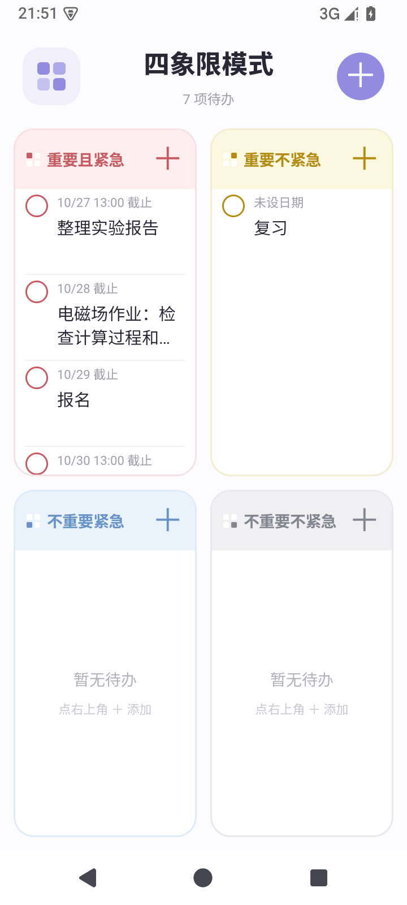
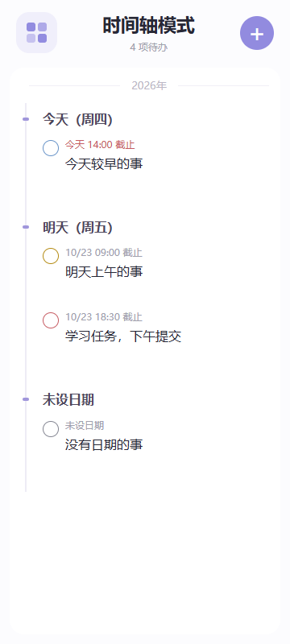
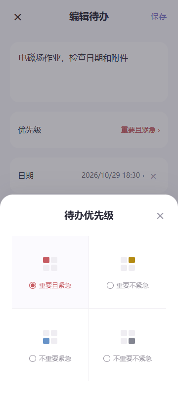
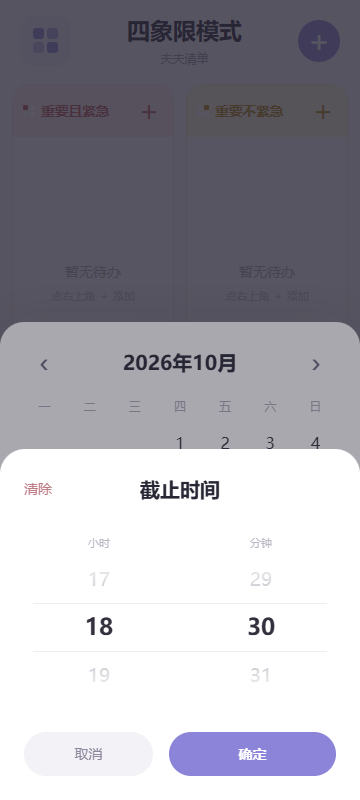
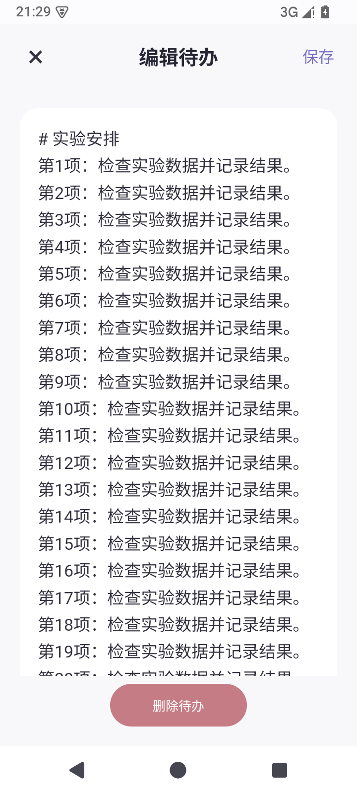
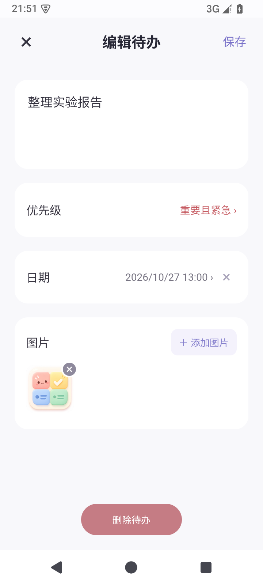
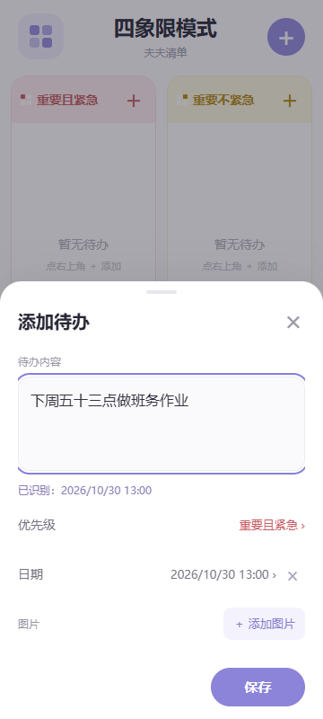

# 夫夫清单 1.0.5

供 Android 手机和平板使用的本地待办清单，支持四象限和时间轴。界面参考用户提供的原子清单截图，应用独立制作。

1.0.5 压缩总览行距，每个象限按可用高度安排约 3.5 条等高待办。总览只显示日期和文字，图片缩略图移到详情中显示。

安卓桌面图标采用用户提供的四格插画，适配不同屏幕密度和系统图标形状；原图保存在 `artwork/launcher-original.png`。


## 下载安装

- [直接下载 1.0.5 安卓安装包](https://github.com/Tabassa/fufu-list/releases/download/v1.0.5/fufu-list-1.0.5.apk)
- [查看最新发布版本](https://github.com/Tabassa/fufu-list/releases/latest)

手机或平板下载 APK 后打开安装，也可以先下载到电脑，再通过 QQ 发送至设备。不需要编译源码。

## 界面



  

同一象限中的待办保持同样高度，文字超出两行时省略显示，正文完整保留。常见手机尺寸约能看到 3.5 条；特别短的屏幕会保留可读行高，显示数量相应减少。总览不加载或展示图片，点开详情后可查看附件缩略图、放大图片，文字框仍按全文展开。





## 使用

1. 将 `fufu-list-1.0.5.apk` 通过 QQ 发送到手机或平板，下载完整后点击安装。若系统要求授权，允许此次用于打开 APK 的 QQ 或文件管理器安装应用。
2. 首次打开就是四象限。点击左上角四象限图标，在「展示模式」中切换四象限或时间轴。时间轴跨象限按截止日期和时间从近到远排列；未设日期和已完成的任务放在后面。
3. 点击任一象限右上角「＋」新增，该象限自动成为默认优先级；右上角总「＋」也可直接新增。点击优先级会弹出彩色四宫格，选中后保存即可移动象限。点击「日期」在月历上选择一天，点击「具体时间」用小时、分钟两列滚轮选择，再点「确定」和「保存」。只有一个截止时间，日期与时间直接显示在任务中。
4. 在详情中点击「添加图片」调用系统选择器，可附多张图片。图片缩略图仅在详情显示，可点开看大图，支持双指缩放；编辑页可移除附件。
5. 点击事项文字进入全屏编辑页，点击圆圈完成或恢复待办。也可以在四象限总览中按住事项从右往左滑，露出右侧删除键。点击删除后仍需点击「确认删除」；取消则保留待办。

无需登录，不含广告；所有界面随安装包提供，不需要联网。任务和图片副本存放在本机应用私有目录。选入的图片会复制保存，后续移动原图不会影响已经保存的附件。

## 正文自动识别截止时间

直接在待办正文写日期和时间，下方会预览识别结果，点击「保存」写入 DDL。完全在设备本地运行，无需 AI、API 密钥或网络；原文保留。



以设备日期为 2026-10-22 为例：

| 正文示例 | 截止日期和时间 |
| --- | --- |
| 下周五十三点做班务作业 / 下周5 13:00交作业 | 2026-10-30 13:00 |
| 周六买书 / 周6买书 | 2026-10-24，不设具体时间 |
| 明天下午两点 / 明天下午2点 | 2026-10-23 14:00 |
| 中午交报告 | 当天 12:00 |
| 下午交报告 | 当天 15:00 |
| 后天上午九点半 / 后天上午9:30 | 2026-10-24 09:30 |
| 十月三十日十三点 / 10月30号13:00 | 2026-10-30 13:00 |

支持汉字、阿拉伯数字及全角数字混用；「周」「星期」「礼拜」均可。每周从周一开始，「下周五」始终指下一自然周的周五；单独「周五」取今天或接下来最近的周五。只写时刻或时段时使用今天，即使这个时刻已经过去。无年份的月日取今天或未来最近一次；晚上十二点按该晚结束后的次日零点处理。

手动通过月历设置或清除日期后，会优先保留手动设置；文字识别结果旁的「使用」可重新启用自动日期。已有任务重新打开默认保持原截止状态，避免「下周五」随着编辑日期改变而后移。新草稿保存时根据当时的设备日期计算。

识别采用常见表达规则，并不理解任意自然语言。正文出现多个日期、时间或无效时间时会提示手动选择，不猜哪个是截止时间；普通题号、数量不会作为时刻。此功能设置截止显示，不会发出系统提醒。

第一版手机和平板分别保存，不自动同步。卸载应用或清除应用数据会删除本地记录。截止日期用于显示和排序，本版未包含系统通知提醒。

安装要求：Android 6.0 及以上，Android System WebView / Chrome 内核 90 及以上。当前 vivo 手机和平板通常已随系统提供该组件；旧版本会显示更新提示。此版本已在 Android 15 模拟器运行验证，尚未连接 vivo 实机测试。

## 构建源码

应用 ID：`com.fufu.todo`，版本：`1.0.5`。Java Activity 承载完全本地的 HTML/CSS/JS 页面，系统文档选择器负责导入图片，`AtomicFile` 保存任务 JSON。不申请网络和广泛相册权限。

使用 Windows PowerShell 7、JDK 17、Android SDK Platform 35 / Build Tools 35.0.0。无需 Gradle 或在线依赖解析。将源码目录与以下 `toolchain` 目录并排放置：

```text
work/
  fufu-list/                 # 克隆或解压后的源码
    build.ps1
  toolchain/
    jdk/bin/java.exe
    sdk/platforms/android-35/android.jar
    sdk/build-tools/35.0.0/
```

在源码目录运行 `./build.ps1`，生成 `build/fufu-list-1.0.5.apk`。第一次构建会在同级 `fufu-signing` 目录生成本地签名密钥。仓库不包含私钥、Android SDK、JDK 或用户数据。重新生成的密钥与 Releases 中 APK 的签名不同；覆盖升级须继续使用原签名密钥。

核心和识别测试：`node --test tests/core.test.js tests/deadline.test.js`。

浏览器检查需要安装 Playwright 并可运行 Edge。先在源码目录执行 `python -m http.server 8766 --bind 127.0.0.1 --directory assets`，再依次执行 `node tests/browser-check.js`、`node tests/lifecycle-check.js`、`node tests/gestures-check.js`、`node tests/time-wheel-check.js`、`node tests/timeline-check.js`、`node tests/deadline-browser-check.js` 和 `node tests/compact-tasks-check.js`。

## 开源来源

任务增删改和筛选基础参考并改编自 [OmerShubi/priority-matrix](https://github.com/OmerShubi/priority-matrix)，MIT 许可。中文界面、月历、图片附件、Android 封装和本地保存为此次新增实现。上游来源和完整许可保留在 `LICENSE` 与 `assets/THIRD_PARTY_NOTICES.txt`，后者也随 APK 打包。

验证记录见 `VALIDATION.md`。
